https://github.com/user-attachments/assets/887e93a2-a74d-4cd1-ba3a-afb79ddd1161


# Bouquet Studio

Pick your flowers, shape the arrangement, wrap it your way, and attach a personal message and a song — then preview, download, or share a custom digital bouquet.

**[Try it live → bouquetgenerator.netlify.app](https://bouquetgenerator.netlify.app)**

[](https://app.netlify.com/projects/bouquetgenerator/deploys)
[](https://nextjs.org)
[](https://react.dev)
[](https://www.typescriptlang.org)
[](https://tailwindcss.com)
[](https://zustand-demo.pmnd.rs)

## What it looks like


Every flower, color, wrap, and ribbon in this preview is picked live in the builder — it's not a static mockup, it's the same SVG the app renders.

## Features

- **Pick your flowers** — rose, tulip, sunflower, lily, daisy, each in multiple colors, with a quantity per flower (0–10)
- **Shape the bouquet** — size (small/medium/large), arrangement style (round/fan/neat), and stem length
- **Wrap & ribbon** — five wrap papers and five ribbon colors
- **Message card** — occasion, a personal message, and a sender name
- **Song** — attach a Spotify track that plays alongside the bouquet
- **Reshuffle** — one click gives the flowers a fresh, randomized arrangement without touching your selections
- **Three flower art styles** — switch between Classic (flat), LEGO (blocky), and Realistic (layered/shaded) rendering, shown below
- **Live SVG preview** that updates instantly as you change any setting
- **Share a link** — generates a short, view-only link (`/result?id=...`) that shows just the bouquet, message, and song, with no editing controls
- **Download** the bouquet as a standalone `.svg` — as a static image, or with a bloom-in animation baked in — with the message rendered right into the file

### Flower styles



## Tech stack

| Layer | Choice |
|---|---|
| Framework | [Next.js](https://nextjs.org) 16 (App Router) |
| UI | [React](https://react.dev) 19 + [Tailwind CSS](https://tailwindcss.com) 4 |
| State | [Zustand](https://zustand-demo.pmnd.rs) |
| Animation | [Framer Motion](https://motion.dev) |
| Icons | [Lucide](https://lucide.dev) |
| Shared-link storage | [Netlify Blobs](https://docs.netlify.com/build/data-and-storage/netlify-blobs/) (14-day expiry), with a URL-encoded fallback when unavailable |
| Song | [Spotify](https://developer.spotify.com/documentation/embeds) embed player |
| Hosting | [Netlify](https://netlify.com) |
| Language | TypeScript |

## Getting started

**Prerequisites:** [Node.js](https://nodejs.org) 18.18 or later, and npm.

Clone the repo and install dependencies:

```bash
git clone https://github.com/GandhiVir/BouquetGenerator.git
cd BouquetGenerator
npm install
```

Start the dev server:

```bash
npm run dev
```

Open [http://localhost:3000](http://localhost:3000) — the app hot-reloads as you edit.

> **Note:** short share links (`/result?id=...`) are backed by Netlify Blobs, which only exists once the app is deployed on Netlify (or run via `netlify dev`). Under plain `npm run dev`, sharing still works — it automatically falls back to encoding the bouquet directly in the URL instead.

### Available scripts

| Command | What it does |
|---|---|
| `npm run dev` | Start the local dev server |
| `npm run build` | Type-check and build for production |
| `npm run start` | Serve the production build |
| `npm run lint` | Run ESLint |

## Deployment

The live site is deployed on [Netlify](https://netlify.com), connected directly to this GitHub repo — every push to `main` triggers a new build and deploy automatically. Build settings live in [`netlify.toml`](netlify.toml); no environment variables are required, since Netlify Blobs is wired up automatically by Netlify's Next.js runtime.

## How to use it

1. Open the **Builder** page from the nav.
2. Pick flowers, colors, and quantities in the *Flowers* card — and choose a flower style (Classic / LEGO / Realistic) at the top.
3. Adjust size, arrangement style, and stem length in *Shape & size*.
4. Choose a wrap paper and ribbon color in *Wrap & ribbon*.
5. Add an occasion, message, and sender name in *Message card*, and optionally a Spotify link in *Song*.
6. Hit **Reshuffle** for a different layout, or **Reset** to start over.
7. Use the icon buttons to **download** the bouquet (static or animated SVG) or **share** a link — or visit the **Result** page for the full summary view.

## Project structure

```
src/
├── app/
│   ├── page.tsx              landing page route
│   ├── builder/page.tsx      the customization screen
│   ├── result/page.tsx       final summary, and the shared/view-only page
│   └── api/bouquets/         Netlify Function routes: create + fetch a shared bouquet
├── components/
│   ├── bouquet/               the SVG rendering pieces (flower heads, ribbon, preview)
│   ├── controls/               reusable form controls (swatches, segmented control, cards)
│   └── shared/                 header, landing page, small shared pieces
├── data/                        flower/wrap/ribbon option lists + default config
├── lib/                         layout math, shuffling, SVG export, share link encode/decode,
│                                Netlify Blobs storage, Spotify URL parsing
├── store/                       Zustand store for the in-progress bouquet
└── types/                       shared TypeScript types
```

## Status & roadmap

This project is under active iteration. Sharing (short links, animated export, and an optional Spotify song) is built and live. Open ideas for later: a static-image share option (canvas-rendered PNG via the Web Share API), and real email delivery of a bouquet (would need a backend mail service).
